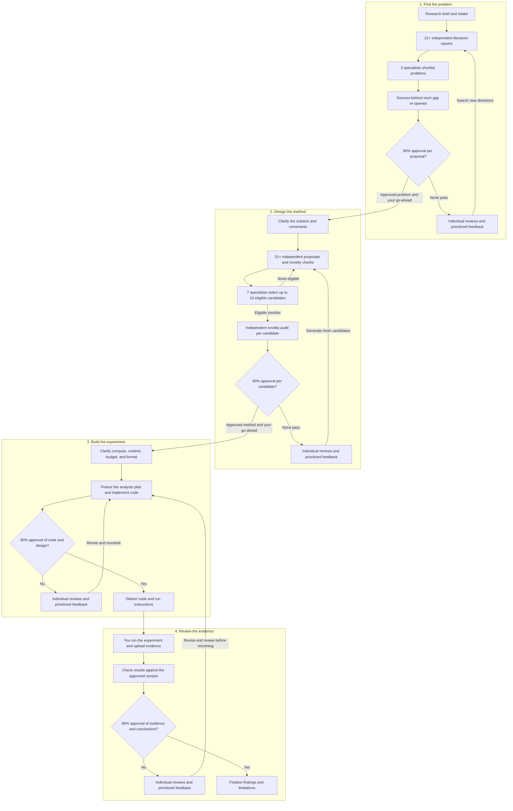

# Rigorbit

**An agent skill for literature review, research design, and reproducible experiments.**

Rigorbit takes a research brief through four stages. It finds a problem grounded in the literature, proposes ways to study it, builds an experiment, and reviews the resulting evidence. Independent agent teams develop and review the work, and you decide when to move from the problem to the methodology and from the methodology to code.

[Quick start](#quick-start) · [Architecture](#architecture) · [Review rules](#review-rules) · [Outputs](#outputs) · [Repository layout](#repository-layout)

## Quick start

**Requirements.** Use an agent host that can load an Agent Skill, search scholarly sources, and delegate work to independent agents. Experiment implementation and testing also require a suitable coding workspace. For research runs, plan for the time and compute needed by your chosen experiment.

For Codex, run this from the unpacked repository root to install the skill for your user account.

```sh
mkdir -p "$HOME/.agents/skills"
cp -R skills/rigorbit "$HOME/.agents/skills/"
```

For a project-only install, copy the same `skills/rigorbit` folder into that project's `.agents/skills/` directory. In Codex, select `$rigorbit` or include it in your prompt. [Official skill setup guide](https://learn.chatgpt.com/docs/build-skills#where-codex-loads-local-skills)

For Claude Code, copy the same folder into your personal skills directory, or into a project's `.claude/skills/` directory for a project-only install.

```sh
mkdir -p "$HOME/.claude/skills"
cp -R skills/rigorbit "$HOME/.claude/skills/"
```

The skill follows the open Agent Skills format, so other hosts that load `SKILL.md` folders can use it the same way. The bundled check script needs Python 3.8 or later and no extra packages.

```text
Use $rigorbit to investigate memory-efficient inference for long-context
language models. I want a method I can test on a single 16 GB GPU in six
hours. Start by asking me what you need to clarify the research scope.
```

Rigorbit starts with a short intake and uses your answers to scope the search. With the intake it shows the round plan, meaning how many agents it will launch in which roles, so you know the size of a round before it starts. After you review the problem report, say **go on** to start methodology design. After you choose a methodology and say **go on** again, Rigorbit asks about your compute budget, experimental depth, and preferred code format before implementation.

Each run keeps its reports, ballots, and checkpoint in a `rigorbit-runs/<run-name>/` folder, so you can pause and resume in a later session.

## Architecture

| Stage | Team | What advances |
| --- | --- | --- |
| **1. Find the problem** | 21+ literature-search agents write independent reports. Three specialists synthesize and shortlist. Other agents re-open the sources behind each gap claim. | A problem proposal with cited evidence, a defensible gap, and a clear reason to pursue it. |
| **2. Design the method** | 51+ independent agents each develop a candidate from a different starting lens. Seven specialists select up to ten eligible candidates. A fresh auditor hunts for prior work against each one. | A testable methodology with an audited novelty score and prior-art comparison. |
| **3. Build the experiment** | Research-design specialists define the evaluation where needed and freeze an analysis plan. Coding specialists implement and test it. | Reviewed code, a frozen analysis plan, and instructions for a reproducible run. |
| **4. Review the evidence** | You run the experiment and supply the results bundle. Rigorbit checks it against the approved version, then an independent panel reviews the results and conclusions. | A results report that distinguishes what the evidence supports from what remains uncertain. |

Each stage uses a panel of **at least 21 independent reviewers**. The panel receives the same versioned materials and submits individual votes and written reviews before seeing the tally. Reviewers are separate from the agents who produced, selected, or coded the work.



### When a review fails

Each reviewer records the reasons for their vote and what needs to change. Three separate feedback specialists combine overlapping comments and select up to ten actionable issues. The next team receives those issues, the review references, and checks for addressing them. A failed results review can send the experiment back through code and design review before you run the next version. Earlier runs stay in the record.

Each gate has a round budget that you agree at intake, three rounds by default. When it is used up without a pass, Rigorbit stops and shows you the closest candidates, the objections that kept recurring, and your options, which include closing the stage with a documented no-go.

## Review rules

### 90% approval

A gate opens when yes votes reach **90% of the full panel, rounded up**. A 21-seat panel needs **19 yes votes**. The tally stays pending until the panel is complete. Each problem and methodology candidate gets its own vote. Approval applies to the submitted version. Reviewer agents apply venue-style criteria, such as those relevant to ACL or IEEE Transactions, as an internal quality gate.

Reviewers open the sources or files their judgment rests on, and every ballot states its strongest objection, including ballots that vote yes. A conditional approval counts as a no. Ballots are saved as files and the tally is computed from them by the bundled script.

### Novelty belongs to each proposal

The methodology team uses a shared rubric fixed before generation. Every agent maps their proposal's substantive components to the closest prior work and records which differences are supported by the evidence. The novelty estimate is the weight of the substantiated new components divided by the weight of all substantive components. Reused or unverified components receive zero novelty credit.

| Score | Eligibility |
| --- | --- |
| **50% or more** | Meets the novelty target. |
| **40% to below 50%** | Eligible only when the agent documents credible attempts to reach 50% and explains why those approaches failed within the agreed constraints. The ranking and review teams verify the justification. |
| **Below 40%** | Ineligible for shortlisting. The individual report is retained with its status. |

The score is an estimate under the documented literature search and rubric. Each report states the closest prior work, the specific differences, and any gaps in the evidence.

The proposing agent's score is treated as a claim. Before review, a fresh agent searches for prior work that would remove each credited part of a shortlisted candidate and rescores it. The audited score decides eligibility.

### Evidence checks

Every source is logged with whether it was opened in full or seen as an abstract only. Before a proposal advances, an agent other than the one that first cited them re-opens the sources its central claims rest on. A reference that cannot be found is treated as nonexistent.

### Execution and resumability

The agent host supplies search, delegation, and execution tools. Teams can run in waves when concurrency is limited. Rigorbit tracks completed assignments, report locations, versioned submissions, votes, and feedback so a pending round can resume. If the required work or panel is incomplete, the checkpoint records what remains open.

Team sizes count real delegated agents only. If the host cannot delegate, Rigorbit says so and stops at what it can honestly do. Every stage report ends with a run record showing the actual agent counts, vote counts, and what could not be verified.

## Outputs

1. **Research problem report.** A plain-language explanation with diagrams, examples, citations, and the review outcome.
2. **Methodology reports.** Individual candidate reports and a clear account of the approved methods, their audited novelty, and how to test them.
3. **Experiment package.** Source code or a notebook, the frozen analysis plan, setup and run instructions, resource estimates, and a step that bundles the outputs to return.
4. **Results report.** Supported conclusions, uncertainty, limitations, and links to the evidence. A well-supported negative or inconclusive result can pass.

## Repository layout

| Path | Purpose |
| --- | --- |
| [`README.md`](README.md) | Public overview, quick start, and architecture |
| [`skills/rigorbit/SKILL.md`](skills/rigorbit/SKILL.md) | Skill entry point and four-stage workflow |
| [`skills/rigorbit/agents/openai.yaml`](skills/rigorbit/agents/openai.yaml) | Display metadata and example invocation |
| [`skills/rigorbit/assets/icon.svg`](skills/rigorbit/assets/icon.svg) | Skill icon |
| [`skills/rigorbit/references/operating-protocol.md`](skills/rigorbit/references/operating-protocol.md) | Agent independence, evidence checks, novelty scoring and audit, voting, and feedback |
| [`skills/rigorbit/references/workspace.md`](skills/rigorbit/references/workspace.md) | Run folder layout, checkpoint, agent ledger, and source ledger |
| [`skills/rigorbit/references/templates.md`](skills/rigorbit/references/templates.md) | Agent briefs, report formats, reviewer ballot, analysis plan, and run manifest |
| [`skills/rigorbit/scripts/rigorbit_check.py`](skills/rigorbit/scripts/rigorbit_check.py) | Gate tally from ballot files and novelty score from a breakdown file |
